### 1. Перевірка перенаправлення та невдалого входу
При спробі доступу до захищеної сторінки без авторизації користувача перенаправляє на сторінку `/login`. При введенні неправильного пароля відображається повідомлення про помилку.

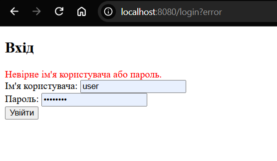

### 2. Перевірка ролі USER
Після входу з роллю `USER` (логін `user`) кнопка створення запису ("Додати нову книгу") є прихованою за допомогою діалекту `sec:authorize`.

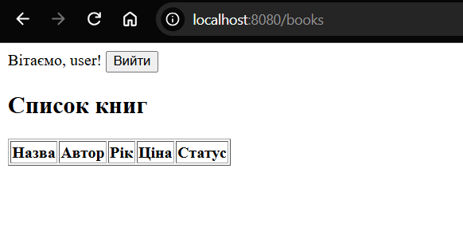

При спробі прямого переходу за адресою `/books/new` користувач без прав `ADMIN` отримує помилку 403 Forbidden.

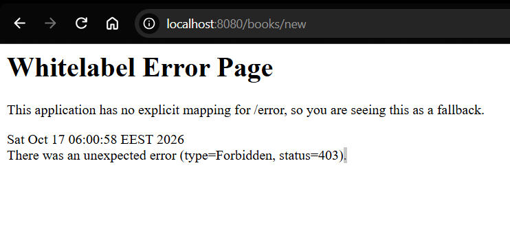

### 3. Перевірка ролі ADMIN та валідації
Після входу з роллю `ADMIN` (логін `admin`) кнопка створення стає видимою.

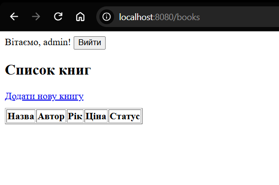

При відправці форми з некоректними даними (наприклад, рік публікації 1222) спрацьовує серверна валідація, і під полем з'являється повідомлення про помилку.

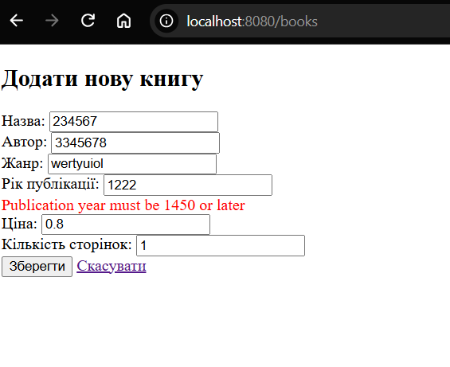

Успішне додавання книги супроводжується повідомленням та перенаправленням на список (патерн PRG).

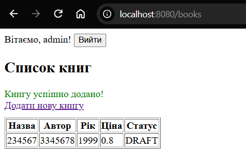

### 4. Перевірка захисту від XSS
При створенні книги з назвою `` текст відображається екранованим (як звичайний текст), а шкідливий скрипт не виконується завдяки використанню директиви `th:text`.

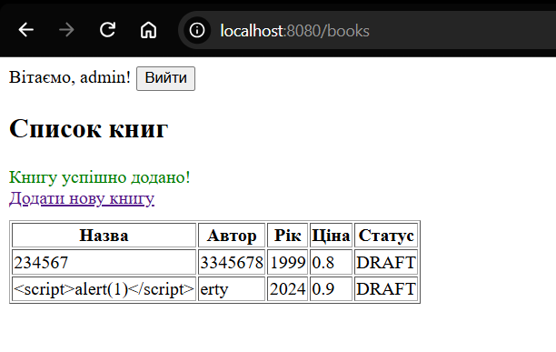

### 5. Перевірка CSRF-токена та PRG
У вихідному коді сторінки форми (або сторінки з кнопкою виходу) присутнє приховане поле `_csrf`, яке генерується автоматично завдяки атрибуту `th:action`.

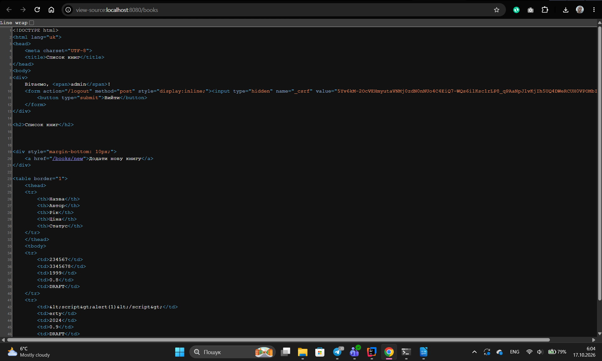

Після успішного створення книги та натискання клавіші F5 (оновлення сторінки) дублікат запису не створюється, що підтверджує роботу патерну Post-Redirect-Get.

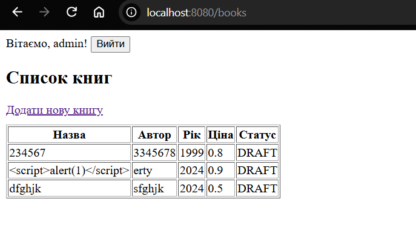

### 6. Перевірка HTTP-кодів відповідей (Status Codes)

Для підтвердження роботи серверного захисту було перевірено HTTP-коди відповідей.

**Перевірка захисту від CSRF (403 Forbidden):**
Спроба відправити POST-запит на створення книги без прихованого токена `_csrf` (імітація атаки) призводить до помилки 403.

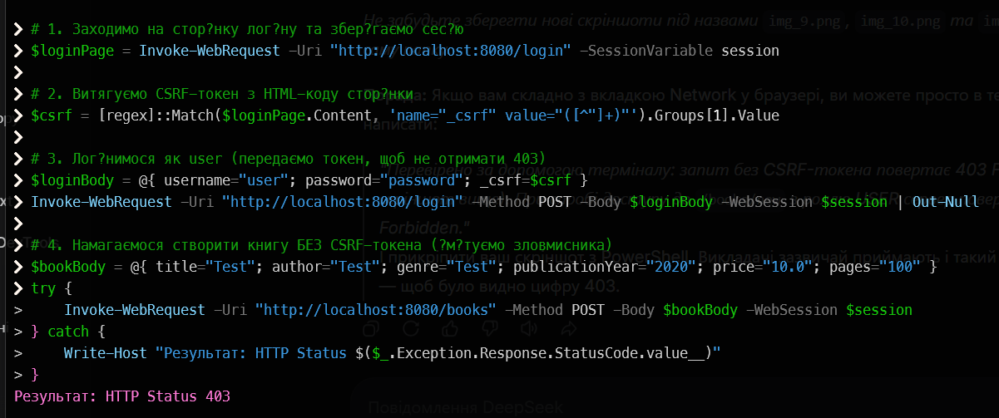

**Перенаправлення неавторизованого користувача (302 Found):**
При спробі доступу до `/books` без входу сервер повертає код 302 та перенаправляє на сторінку `/login`.

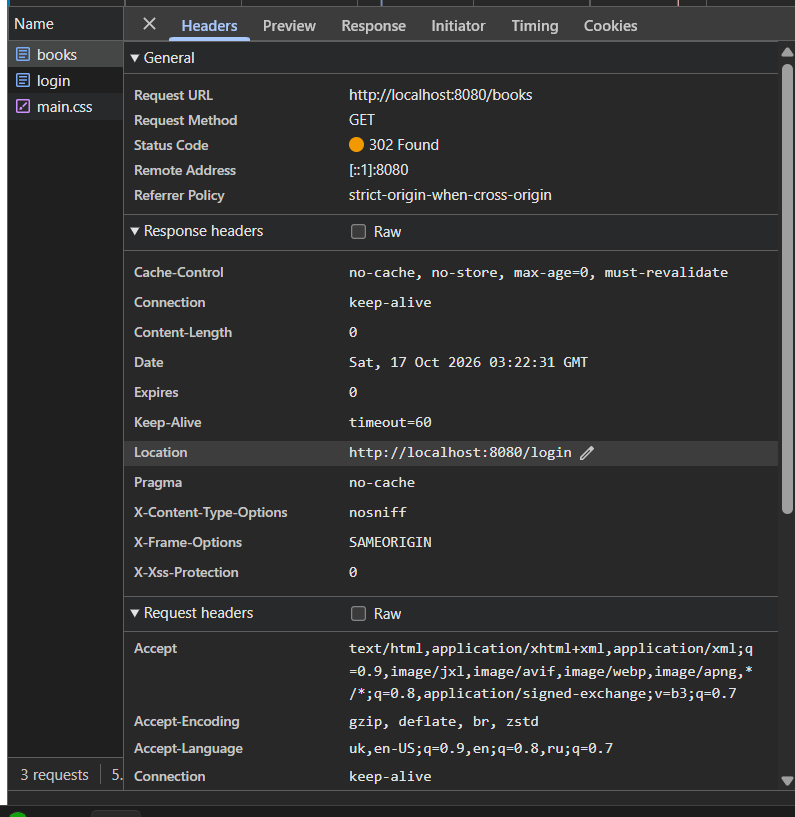

**Заборона доступу для ролі USER (403 Forbidden):**
При спробі користувача з роллю `USER` напряму відкрити сторінку `/books/new` сервер повертає код 403 Forbidden.

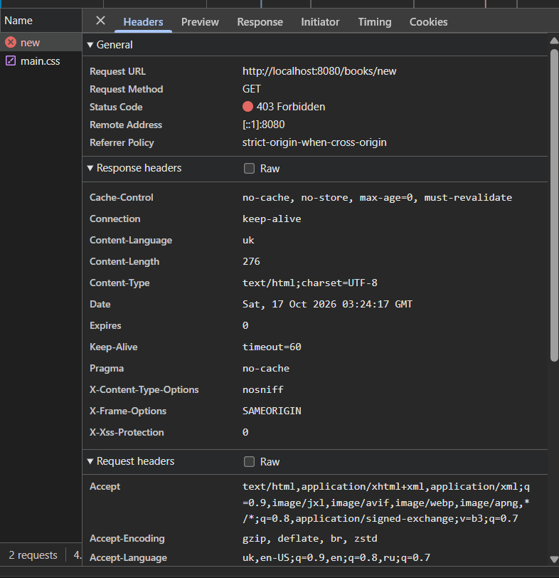

**Успішне створення та патерн PRG (302 Found):**
Після успішного надсилання форми створення книги (POST) сервер повертає код 302 Found і перенаправляє на список `/books`, що запобігає дублюванню даних при оновленні сторінки.

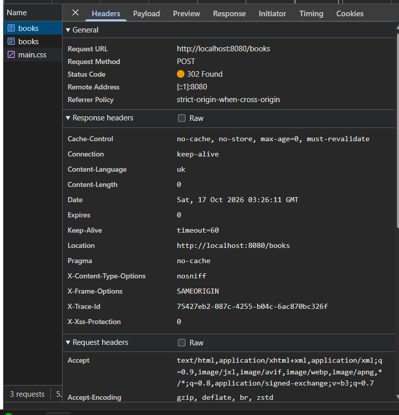

