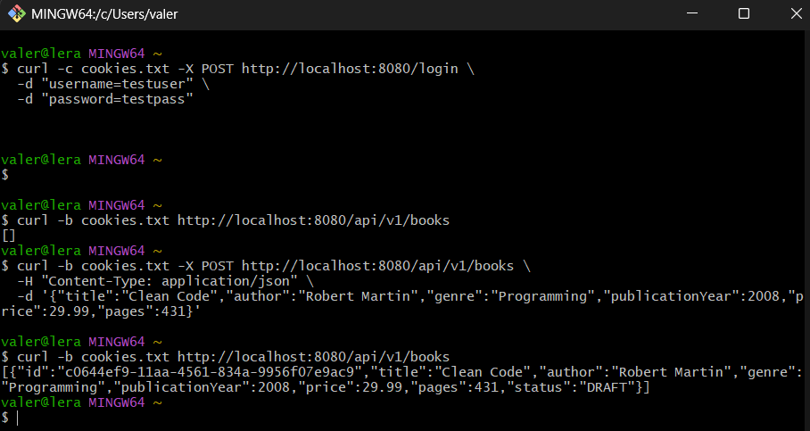
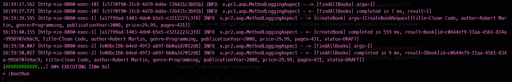

# Звіт до лабораторної роботи: Аспектно-орієнтоване програмування

## 1. Мета роботи
Налаштувати Spring Boot проєкт для роботи з AOP, створити кастомну анотацію та аспект для логування викликів методів через SLF4J.

## 2. Що було зроблено
1. **Залежності:** У `build.gradle.kts` підключено стартер `spring-boot-starter-aspectj`.
2. **Кастомна анотація:** Створено маркерну анотацію `@LogMethodCall` (пакет `vfrolenko.pr2.aop`) з областю видимості `RUNTIME`, призначену для методів.
3. **Аспект:** Створено компонент `@Aspect` (`MethodLoggingAspect`), який за допомогою поради `@Around` перехоплює виклики анотованих методів. Аспект логує аргументи, час виконання та результат (або виняток).
4. **Розміщення:** Анотацією `@LogMethodCall` позначено методи `findAll()`, `findById(UUID)` та `create(CreateBookRequest)` у класі `BookServiceImpl`.

## 3. Демонстрація роботи

Було виконано запити через `curl` (з попередньою авторизацією).
На скріншоті нижче видно створення книги та отримання списку книг:

Після виконання запитів у консолі застосунку з'явилися логи від аспекту. Завдяки наявному `TraceIdFilter` (MDC), кожен виклик автоматично супроводжується унікальним `traceId`. Видно вхідні аргументи, результат виконання та час роботи методу (наприклад, `completed in 559 ms`):

## 4. Тестування
Для підтвердження того, що аспект коректно працює через Spring-проксі, було написано інтеграційний тест `MethodLoggingAspectTest`. Він піднімає контекст `@SpringBootTest` та за допомогою Logback `ListAppender` перехоплює логи, перевіряючи, що виклик методу `findAll()` дійсно генерує повідомлення про вхід та вихід у журналі. Тест успішно проходить.